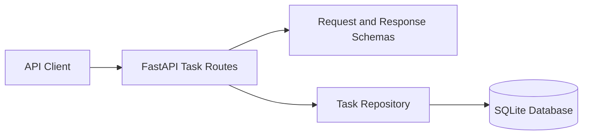

# Task Management REST API Architecture

## 1. Scope

KAN-26 is a separate project from KAN-25 Calculator. The proposed project root is `projects/kan-26-task-api/` in this repository. It will have its own dependencies, source tree, SQLite file, tests, and run instructions; it will not import or alter the calculator application.

## 2. Overview

A local FastAPI application exposes task CRUD endpoints and persists task records in a project-local SQLite database. The application is a JSON REST API; no web frontend is required by KAN-26.

## 3. Components And Responsibilities

- Application entry point (`projects/kan-26-task-api/src/main.py`): creates the FastAPI app and mounts task routes.
- Task routes (`projects/kan-26-task-api/src/routers/tasks.py`): implement the five specified HTTP endpoints and response codes.
- Request/response schemas (`projects/kan-26-task-api/src/schemas.py`): validate task inputs, status values, and response fields.
- Persistence (`projects/kan-26-task-api/src/database.py`): opens the project-local SQLite database and manages connections/schema initialization.
- Data access (`projects/kan-26-task-api/src/repository.py`): implements task create, list, get, partial update, and delete queries.
- Tests (`projects/kan-26-task-api/tests/`): verify endpoint behavior, persistence, status validation, IDs, and missing-task responses.

## 4. Data Model

| Field | SQLite representation | Behavior |
|-------|------------------------|----------|
| id | `INTEGER PRIMARY KEY AUTOINCREMENT` | Assigned by SQLite. |
| title | `TEXT NOT NULL` | Required user value. |
| description | `TEXT NOT NULL` | Required user value. |
| status | `TEXT NOT NULL DEFAULT 'todo'` | Allowed values are `todo`, `in_progress`, `done`. |

## 5. API Design

| Method | Path | Success behavior |
|--------|------|------------------|
| POST | `/tasks` | HTTP 201 and created task with assigned ID. |
| GET | `/tasks` | HTTP 200 and JSON array, including `[]` when empty. |
| GET | `/tasks/{id}` | HTTP 200 and task object when found. |
| PATCH | `/tasks/{id}` | HTTP 200; only supplied fields change. |
| DELETE | `/tasks/{id}` | HTTP 200 and confirmation message. |

For a missing task ID, return HTTP 404 with the exact message `Task with ID {id} does not exist`, per FR-008.

## 6. Data Flow

1. FastAPI validates a request against its schema.
2. The route calls the task repository.
3. The repository executes a parameterized SQLite query using a connection from the database component.
4. The route returns a response model and the required status code.

## 7. Decisions And Boundaries

- Use SQLite because it is explicitly required by KAN-26.
- Keep KAN-26 dependencies and source isolated under `projects/kan-26-task-api/` so the KAN-25 calculator remains unchanged.
- Do not add authentication, pagination, sorting, task history, frontend UI, or deployment infrastructure; these are not specified by the story.
- Jira lists five explicit acceptance criteria. Proposed verification for FR-006 through FR-008 is deferred to implementation-plan approval and must not be presented as original Jira acceptance criteria.

## 8. Architecture Diagram

