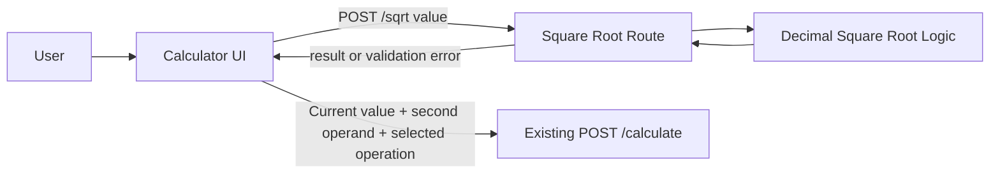

# Calculator Square Root Architecture

## 1. Scope

KAN-27 extends the KAN-25 Calculator application. Keep the existing calculator project, binary API, and persistence-free design; do not touch the separate KAN-26 Task Management project.

## 2. Current Application

The current UI has first and second numeric inputs, a binary-operation selector, a Calculate action, and a separate result output. The backend exposes `POST /calculate` with two decimal operands and one binary operation.

## 3. Proposed Design

- Add a unary square-root action to the calculator UI, visibly labeled `√` and available to mouse/touch users.
- The action operates on the current displayed value, represented by the first-number input or latest result.
- Add a separate `POST /sqrt` endpoint so the existing binary `/calculate` request/response contract remains unchanged.
- The request contains one decimal value. The backend rejects a negative value with HTTP 422 and the exact Jira error message; non-negative values return the square-root result.
- On success, the frontend immediately updates the result output and replaces the first-number value with the square-root result. The second-number value and selected binary operation remain available so Calculate can use the root as the next operand.
- Use Python `Decimal` arithmetic. Limit the displayed value to at most eight fractional decimal places, round half-up, and trim trailing zeros as explicitly approved by the user.

## 4. API Contract

### `POST /sqrt`

Request:

```json
{
  "value": "20.25"
}
```

Successful response:

```json
{
  "result": "4.5"
}
```

Negative input returns HTTP 422 with detail:

```text
Invalid input. Square root of a negative number is not supported.
```

## 5. Data Flow

1. User enters a non-negative number in the current value field and selects `√`.
2. The browser sends the decimal value to `POST /sqrt`.
3. FastAPI validates the request and calls pure square-root calculation logic.
4. The backend returns a result formatted to the approved maximum precision.
5. The browser updates the result output and current first operand without reloading the page.
6. The user can continue with the selected binary operation and second operand.

## 6. Non-Functional Considerations

- The calculation is local numeric work; maintain a one-second response target.
- Preserve existing binary operations and their API behavior.
- No database, external service, or new framework is required.

## 7. Architecture Diagram



## 8. Open Decision

Jira sets a maximum precision example of eight decimal places but does not state rounding or trailing-zero behavior. The user explicitly approved round-half-up and trailing-zero trimming before implementation.