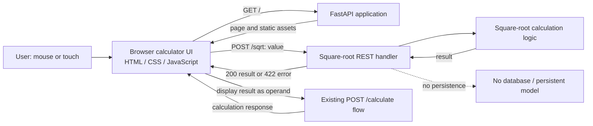

# KAN-28 Architecture

## Status and scope

This design is based on the human-approved `docs/sessions/KAN-28/plans/requirements.md` for KAN-28. Its recorded source is the actual issue content read from the user's authenticated shared Jira browser; no Jira MCP retrieval is claimed. This artifact designs only the approved square-root behavior and its integration with the existing calculator. It does not add a database or broaden the application scope.

## Approved KAN28-PLN-01 clarifications

The user explicitly approved these refinements for the existing FR-003 and NFR-001 requirements. They resolve the corresponding architecture decisions without changing the requirements artifact:

- **Precision and rounding (FR-003, NFR-002):** quantize square-root results to 8 decimal places using `ROUND_HALF_UP`. The precision source is the named module-level integer constant `SQUARE_ROOT_PRECISION = 8` in `src/calculator.py`, used by the existing quantize behavior to derive the 8-place quantum. This is a code-level constant only; do not add a settings service, environment variable, or infrastructure.
- **One-second measurement boundary (NFR-001):** measure from activation of `√` in the browser until the result is displayed in the browser. The interval includes the browser/API round trip, computation, and result presentation; it is not a backend-only timing boundary.

## System overview

A browser-based HTML/CSS/JavaScript calculator sends a square-root request to a stateless Python/FastAPI service. The service validates the value, computes its square root, and returns a result. The browser replaces the current display with that result. The display is transient client-side state and can be used as input to the calculator's existing subsequent-calculation flow.

## Components and responsibilities

| Component | Responsibility | Traceability |
|---|---|---|
| Calculator page (`index.html`) | Present the calculator display and a clearly labeled `√` control. | FR-001, FR-005, NFR-003 |
| Stylesheet (`style.css`) | Style the page and control so the operation is clear and usable with mouse/touch. | NFR-003 |
| Browser logic (`app.js`) | Read the current display value, send the request, show the returned result in place, show the specified negative-input message, retain the result in the display for subsequent calculations, and define the NFR-001 measurement start/end at √ activation/result display. | FR-002, FR-004–FR-006, NFR-001 |
| FastAPI application and static-file serving | Serve the calculator page/assets and expose the REST endpoints. | FR-001, FR-005 |
| Square-root API handler | Validate the request, call the calculation logic, return the result or a client error for a negative input; do not retain request data. | FR-001–FR-004 |
| Calculation logic | Compute the square root and quantize to 8 decimal places with `ROUND_HALF_UP`, using the named module-level precision constant in `src/calculator.py`. | FR-001, FR-003, NFR-002 |
| Existing calculation flow (`POST /calculate`) | Continue accepting the displayed square-root result for subsequent calculations; its behavior is otherwise unchanged by this design. | FR-006 |

## REST endpoints

### `POST /sqrt`

Accepts one JSON request and returns one JSON response. No user or session state is stored by the service.

**Request**

```json
{"value": "9"}
```

`value` is the current decimal input represented as a string, including zero, positive integers, and positive decimals. This matches the browser's form value and avoids converting user-entered decimal text through JavaScript binary floating-point before the service parses it as a decimal.

**Successful response (`200 OK`)**

```json
{"result": "3"}
```

`result` is a decimal string representing the computed value. The display must not exceed the configured decimal precision (FR-003); precision is 8 decimal places with `ROUND_HALF_UP`. Existing result formatting may omit trailing zeroes.

**Negative input**

Return a client error (proposed `422 Unprocessable Entity`) with the exact required message available to the browser:

```json
{"detail": "Invalid input. Square root of a negative number is not supported."}
```

The browser displays that exact message and remains usable (FR-004).

### Existing endpoints

- `GET /` serves the calculator page; `/static/...` serves its frontend assets.
- `POST /calculate` remains the existing subsequent-calculation endpoint. The browser submits the square-root result as `first_number` with the user's `second_number`; no change to the endpoint contract is specified by KAN-28 (FR-006).

## Data model

There is **no persistent data model** and no database. Request/response values are transient:

- Square-root request: `value` (JSON string containing decimal text).
- Square-root success response: `result` (decimal string).
- Negative-input error: a client-error message containing the exact required text.
- Browser inputs and displayed result: transient page state. The browser sends the current value as decimal text; the service parses it as a decimal and returns the formatted result as text.
- Subsequent calculation: the displayed square-root result is copied into the existing first-number input and submitted through `POST /calculate` as its `first_number` operand.
- Precision configuration: the named module-level integer constant `SQUARE_ROOT_PRECISION = 8` in `src/calculator.py` supplies the decimal-place count for quantization. No settings service, environment variable, or new infrastructure is introduced.

## Request and data flow

1. The one-second measurement starts when the user activates the `√` control in the browser. The browser uses the current result if one is displayed; otherwise, it uses the first-number input. The control is available by mouse/touch. (FR-001, FR-002, NFR-001, NFR-003)
2. Browser logic sends `POST /sqrt` with that value as decimal text.
3. FastAPI validates the value and calls the square-root calculation logic. The service quantizes to 8 decimal places with `ROUND_HALF_UP`, using `SQUARE_ROOT_PRECISION = 8` to derive the quantization quantum, and returns a result without persisting input or output. (FR-001, FR-003, NFR-002)
4. For success, the browser shows the result in the result panel and copies it into the first-number input, limited to the configured precision. This replaces the active value and makes the result available as the first operand in the existing calculation flow. The one-second measurement ends when the result is displayed in the browser. (FR-003, FR-005, NFR-001)
5. A subsequent calculation submits the first-number input and the user's second-number input to the existing `POST /calculate` endpoint. (FR-006)
6. For a negative value, the API reports the specified message; the browser displays it exactly and remains responsive. (FR-004)

## Mermaid component diagram



## Unresolved decisions

- The story specifies mouse/touch access but no additional accessibility criteria (NFR-003).
